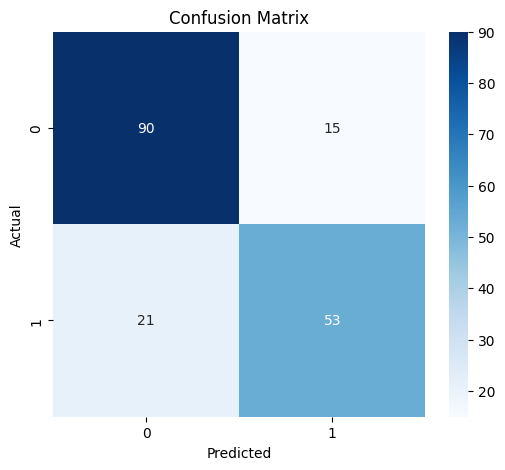

# 🚢 Titanic Survival Prediction using Logistic Regression

A machine learning project in Python that predicts whether a Titanic passenger survived, using a Logistic Regression model.

---

## 📌 Problem Statement

The sinking of the Titanic is one of the most well-known disasters in history, and not all passengers had the same chance of survival. This project builds a **binary classification model** that predicts whether a passenger survived (`1`) or did not survive (`0`) using details such as passenger class, sex, age, family members aboard, fare and port of embarkation.

---

## 📂 Dataset

- **File used:** `TITANIC TRAIN.csv` (Titanic training dataset)
- **Size:** 891 rows and 12 columns
- **Target variable:** `Survived` (0 = No, 1 = Yes)
- **Overall survival rate:** about 38.4% of passengers survived

**Missing values found:**

| Column | Missing values |
|---|---|
| Age | 177 |
| Cabin | 687 |
| Embarked | 2 |

---

## 🛠️ Tools & Libraries

- **Language:** Python
- **Data handling:** Pandas, NumPy
- **Visualization:** Matplotlib, Seaborn
- **Machine learning:** Scikit-learn (`LogisticRegression`, `train_test_split`, `accuracy_score`, `confusion_matrix`, `classification_report`)
- **Environment:** Google Colab

---

## 🔄 Project Workflow

1. **Import libraries and load data**
   - Uploaded the CSV in Google Colab and read it with `pd.read_csv()`
   - Inspected the data using `head()`, `describe()` and `shape`

2. **Data cleaning**
   - Checked missing values with `isnull().sum()`
   - Checked for duplicate rows with `drop_duplicates()` (none found, the dataset stayed at 891 rows)
   - Filled the missing values in `Age`, `Cabin` and `Embarked`
   - Dropped columns not used for modelling: `Name`, `Ticket`, `Cabin` and `PassengerId`

3. **Exploratory data analysis (EDA)**
   - Count plot of survival by **Sex**
   - Count plot of overall **Survived** distribution
   - Count plot of survival by **Passenger Class (Pclass)**

4. **Feature encoding**
   - Converted the categorical columns `Sex` and `Embarked` into numeric form using `pd.get_dummies(drop_first=True)`

5. **Train/test split**
   - Separated features (`X`) and target (`y = Survived`)
   - Split the data into **80% training and 20% testing** (`random_state=42`), giving 179 passengers in the test set

6. **Handling missing age values**
   - Converted `Age` to numeric
   - Filled the missing ages with the **median age of the training set**, and used the same value for the test set to avoid data leakage

7. **Model training**
   - Trained a `LogisticRegression` model (`solver='liblinear'`, `max_iter=1000`, `random_state=42`)

8. **Model evaluation**
   - Predicted survival on the test set
   - Calculated accuracy, the confusion matrix (plotted as a heatmap) and the classification report

---

## 📊 Results

**Accuracy: 79.9%** on the test set of 179 passengers.

| Class | Precision | Recall | F1-score | Support |
|---|---|---|---|---|
| 0 (Did not survive) | 0.81 | 0.86 | 0.83 | 105 |
| 1 (Survived) | 0.78 | 0.72 | 0.75 | 74 |
| **Weighted average** | 0.80 | 0.80 | 0.80 | 179 |

### Confusion Matrix



|  | Predicted: Did not survive | Predicted: Survived |
|---|---|---|
| **Actual: Did not survive** | 90 | 15 |
| **Actual: Survived** | 21 | 53 |

Out of 179 test passengers, the model classified 143 correctly (90 + 53) and 36 incorrectly (15 + 21).

---

## 💡 Key Insights

- **Sex was a strong factor.** Most male passengers did not survive (roughly 470 did not survive against about 110 who did), while most female passengers did (roughly 230 survived against about 80 who did not).
- **Passenger class mattered.** Third-class passengers had the worst outcome, with roughly 370 not surviving against about 120 who survived. First-class passengers were the only group where more survived than not.
- **Overall survival was low.** Only about 38% of passengers in the dataset survived.
- **The model performs reasonably well.** It reaches about 80% accuracy and is better at identifying passengers who did not survive (recall 0.86) than those who did (recall 0.72).

*(Counts in the first two points are read from the count plots, so they are approximate.)*

---

## 🚀 Future Improvements

- Create new features such as family size
- Try other models such as Random Forest or Decision Tree and compare their accuracy
- Use cross-validation for a more reliable evaluation
- Scale numerical features and tune the model's parameters

---

## 📁 Repository Structure

```
titanic-survival-prediction/
├── README.md
├── data/
│   └── TITANIC TRAIN.csv
├── TITANIC_REGRESSION_PROJECT.ipynb
└── images/
    └── confusion_matrix.png
```

---

## ▶️ How to Run

1. Open `TITANIC_REGRESSION_PROJECT.ipynb` in **Google Colab** (upload it, or use "Open in Colab" from GitHub).
2. Run the upload cell and select `TITANIC TRAIN.csv` from the `data` folder.
3. Run all cells from top to bottom (**Runtime → Run all**).

To run it locally instead, install the libraries and open the notebook in Jupyter:

```bash
pip install pandas numpy matplotlib seaborn scikit-learn jupyter
jupyter notebook
```

---

## 👤 Author

**Bhargav Chakraborty**
BTech in Electrical Engineering and MBA (Operations)
(Data Analytics and Visualization using Python , Jadavpur University)
(Professional Certificate Course in Data Analytics and Generative AI, E&ICT Academy, IIT Kanpur)

- LinkedIn: https://www.linkedin.com/in/bhargav-chakraborty-1592b5202/
